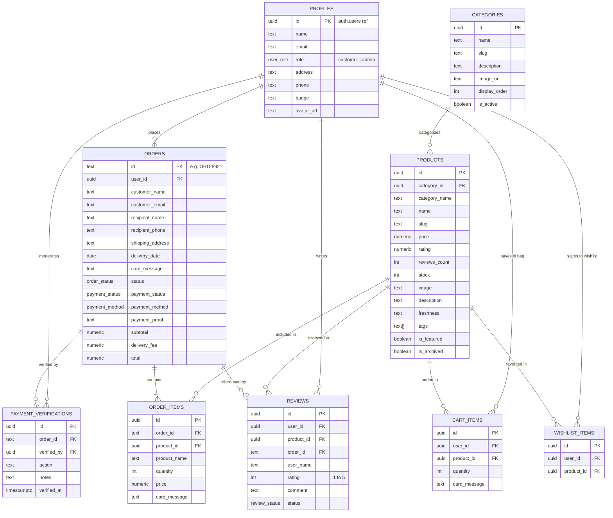

# Supabase Database Architecture - Ron's Bloom Crafts

This directory contains the database definition, automated triggers, performance indexes, Row Level Security (RLS) policies, storage bucket configurations, and seed data tailored for **Ron's Bloom Crafts**.

---

## 📁 Files Overview

- **`schema.sql`**: Full schema definition with PostgreSQL extensions, custom ENUMs, 9 relational tables, indexes, triggers, RLS policies, and storage setup.
- **`seed.sql`**: Initial florist catalog matching the storefront and order management pipeline (`INITIAL_PRODUCTS`, `CATEGORIES`, `INITIAL_ORDERS`).
- **`src/types/database.types.ts`**: TypeScript definitions automatically aligned with all tables, views, and functions.

---

## 🗄️ Relational Entity-Relationship Structure



---

## 🔒 Security & Row Level Security (RLS)

All tables have RLS enabled with strict policy enforcement:

| Table | Public Access | Authenticated Customer | Admin / Master Florist |
| :--- | :--- | :--- | :--- |
| **`profiles`** | ❌ None | Read/Update own profile | Full access |
| **`categories`** | Read active categories | Read active categories | Full CRUD |
| **`products`** | Read unarchived products | Read unarchived products | Full CRUD |
| **`orders`** | Insert (guest checkout) | Read/Insert own orders | Read/Update all (pipeline dispatch) |
| **`order_items`**| Linked order insert | Read items of own orders | Full access |
| **`reviews`** | Read approved reviews | Submit review for products | Full moderation & CRUD |
| **`cart_items`** | ❌ None | Full CRUD on own items | Full access |
| **`wishlist_items`** | ❌ None | Full CRUD on own items | Full access |
| **`payment_verifications`** | ❌ None | ❌ None | Full CRUD |

---

## ⚙️ Automated Triggers

1. **`on_auth_user_created`**: Automatically creates a record in `public.profiles` whenever a customer or admin registers through Supabase Auth.
2. **`on_review_change`**: Automatically recalculates product `rating` and `reviews_count` whenever a review is approved, edited, or deleted.
3. **`set_*_updated_at`**: Automatically touches `updated_at` on every record modification.

---

## 🚀 How to Apply

### Option A: Supabase Dashboard
1. Open your project on [Supabase Dashboard](https://supabase.com/dashboard).
2. Go to the **SQL Editor** tab.
3. Paste the contents of `supabase/schema.sql` and click **Run**.
4. (Optional) Paste `supabase/seed.sql` to populate sample bouquets and initial pipeline orders.

### Option B: Supabase CLI
```bash
# Link your Supabase project
supabase link --project-ref <your-project-ref>

# Push the schema
supabase db push

# Or run the schema directly
supabase db reset
```
